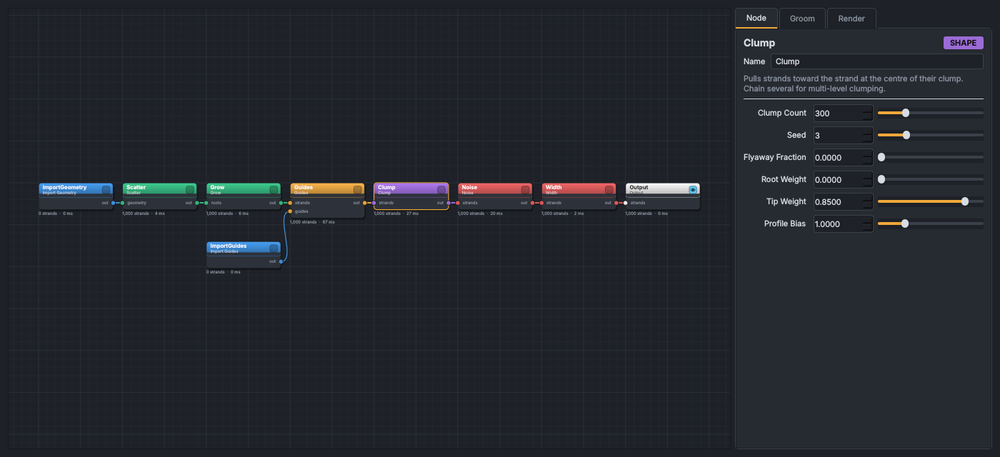
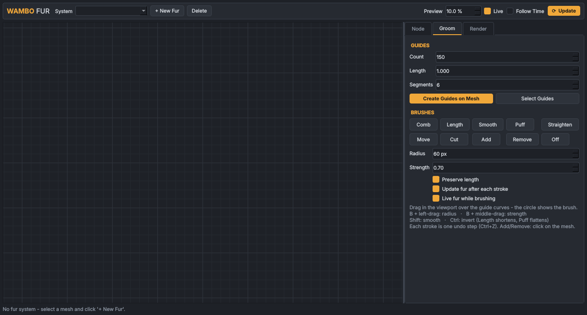

# Wambo Fur — sistema de pelos/cabelos procedural para Maya 2024+

Plugin de grooming procedural para Autodesk Maya **2024, 2025, 2026+** (PySide2 e PySide6),
com renderização em **Arnold** e **V-Ray**.

O fluxo de trabalho é o mesmo de ferramentas profissionais de groom baseadas em grafo:
- você monta um **grafo de nós** (importar malha → espalhar raízes → crescer → guias → clump → ruído → largura → saída);
- **penteia guias** direto no viewport com pincéis;
- vê um **preview com densidade reduzida** no viewport;
- e manda a **densidade total** para o renderizador como procedural/cache.

> Projeto original. Não usa código, ícones nem marcas de nenhum produto comercial.



## Instalação

1. Copie a pasta `WamboFur` para qualquer lugar do seu disco.
2. Abra o Maya e **arraste `install_wambofur.py` para o viewport**.
   O instalador cria `WamboFur.mod` na pasta de módulos do Maya, carrega o plugin e o marca como auto-load.
3. Aparece o menu **Wambo Fur** na barra principal.

Instalação manual: crie `Documents/maya/modules/WamboFur.mod` com:
```
+ WamboFur 1.0.0 C:/caminho/para/WamboFur
MAYA_PLUG_IN_PATH +:= plug-ins
PYTHONPATH +:= scripts
```
e carregue `wamboFur.py` no Plug-in Manager.

## Uso rápido

1. Selecione uma malha poligonal → **Wambo Fur ▸ Wambo Fur Editor… ▸ + New Fur**.
2. O grafo inicial já aparece e o preview é desenhado no viewport (10% da densidade).
3. Clique num nó para editar parâmetros (painel **Node**). Com **Live** ligado, o viewport atualiza na hora.
4. Aba **Groom** ▸ *Create Guides on Mesh*. Os nós *Import Guides* + *Guides* são ligados no grafo sozinhos.
   Depois é só escolher um pincel e pentear.
5. Aba **Render** ▸ escolha **Arnold** ou **V-Ray** ▸ *Export Current Frame* (ou *Export Sequence* para animação).

### Atalhos do grafo
| Tecla / mouse | Ação |
|---|---|
| `Tab` ou botão direito no vazio | criar nó (busca) |
| arrastar saída → entrada | conectar (arrastar uma entrada já ligada desconecta/reconecta) |
| `D`, duplo clique ou ícone de olho | nó exibido no viewport |
| `B` | bypass |
| `Del` | apagar |
| `F` | enquadrar tudo |
| botão do meio / `Alt`+esquerdo, roda do mouse | pan e zoom |

Selecionar um nó e criar outro faz a ligação automática em sequência.

## Nós

| Categoria | Nó | O que faz |
|---|---|---|
| Import | **Import Geometry** | malha de crescimento |
| Import | **Import Guides** | curvas-guia penteadas |
| Generate | **Scatter** | espalha raízes por área; *Density Map* (textura 2D) |
| Generate | **Grow** | cresce fios (comprimento, variação, segmentos, inclinação, *Length Map*) |
| Guide | **Guides** | fios herdam forma/comprimento das guias (raio, nº de guias, peso, falloff) |
| Shape | **Clump** | agrupamento; encadeie vários para clumps multinível; *flyaways* |
| Shape | **Comb** | penteia para uma direção mantendo comprimento |
| Shape | **Gravity** | gravidade com rigidez da raiz, preservando comprimento |
| Shape | **Curl** | cachos em espiral |
| Modify | **Noise** | ruído fractal (frizz, ondulação); *fraction* para fios rebeldes |
| Modify | **Length / Scale** | escala do comprimento (+ mapa) |
| Modify | **Cut** | aparo aleatório das pontas |
| Modify | **Width** | espessura raiz → ponta |
| Modify | **Prune** | remove fios aleatoriamente (+ mapa) |
| Utility | **Merge** | junta dois fluxos de fios |
| Output | **Output** | resultado final que vai para o render |

Todos os nós com perfil têm **Root Weight / Tip Weight / Profile Bias**, que controlam o efeito ao longo do fio.
A aleatoriedade é por fio e estável: o preview a 10% mostra exatamente os mesmos fios que o render, só que menos.

## Pincéis de groom

**Comb, Length, Smooth, Puff, Straighten, Move, Cut, Add, Remove**, com raio (pixels), força e *Preserve length*.

- Um **círculo segue o mouse no viewport** e mostra a área do pincel. A cor muda conforme o modo,
  o anel tracejado indica a força e o nome do pincel aparece embaixo.
- **B + arrastar com o botão esquerdo**: muda o raio. **B + arrastar com o botão do meio**: muda a força
  (igual aos pincéis do Maya).
- **Shift**: suaviza temporariamente. **Ctrl**: inverte (Length encurta, Puff deita os fios).
- **Live fur while brushing**: o pelo final atualiza *durante* a pincelada, quando a avaliação é rápida.
  Para grooms pesados, baixe o *Preview %*.
- Cada pincelada é **um passo de undo** (Ctrl+Z), registrado por um comando nativo, sem custo extra.

Também estão no menu Wambo Fur.



## Renderização

### Render direto, sem exportar (estilo Yeti)
Na aba **Render**, marque **Export automatically when rendering**. Isso adiciona um gancho em
*Render Settings ▸ Common ▸ Render Options ▸ Pre render frame MEL*. A partir daí, cada frame renderizado
(Render View, batch render ou render farm) gera o pelo daquele frame antes de renderizar.
É só apertar **Render**, tanto no Arnold quanto no V-Ray.
Na farm, o plugin precisa estar instalado nas máquinas (o módulo `WamboFur.mod`). O gancho carrega o plugin sozinho.

> O IPR (render interativo) não executa o *Pre render frame MEL*. Nele, use *Export Current Frame* uma vez.

### Arnold (MtoA)
`Export` grava `<projeto>/cache/wambofur/<sistema>.ass` com:
- nó `curves` (modo *thick*, raio por ponto, suavização Catmull-Rom);
- shader `standard_hair` embutido;
- user data `wf_rand` (aleatório por fio) e `wf_rootuv` (UV da raiz), para variar cor com `aiUserDataFloat`/`aiUserDataVec2`.

Um **aiStandIn** é criado/atualizado dentro do sistema. Em sequência, usa `####` + *frame extension*.

### V-Ray
`Export` grava um **Alembic** (`.abc`) com todas as curvas num único objeto e **larguras por ponto**,
e cria um **VRayProxy** com um **VRayHairNextMtl** atribuído. Esse é o caminho nativo de hair do V-Ray.
Em sequência, um *expression* troca o arquivo a cada frame (funciona em render farm).
O mesmo `.abc` também pode ser carregado num aiStandIn.

> O caminho do V-Ray cria temporariamente curvas Maya na densidade total para o `AbcExport`;
> com centenas de milhares de fios, a exportação leva alguns segundos/minutos.

### Linha de comando / farm
```python
import maya.cmds as cmds
cmds.wamboFur(export=True)                       # todos os sistemas, frame atual
cmds.wamboFur(export=True, start=1, end=120)     # sequência
cmds.wamboFur(update=True)                       # atualiza previews
```

## Animação
Marque **Follow Time** para reavaliar a cada frame (malhas deformadas). As raízes ficam presas por
triângulo + baricêntrica, então os fios acompanham a deformação. Para render, use *Export Sequence*.
As guias são curvas estáticas: em personagens animados, penteie na pose de rest.

## Estrutura
```
WamboFur/
  install_wambofur.py     instalador drag & drop
  plug-ins/wamboFur.py    plugin (comando wamboFur + menu)
  scripts/wambofur/
    core/                 motor puro Python (testável fora do Maya; usa numpy se houver)
    maya/                 leitura de cena, sistema, pincéis, exportação Arnold/V-Ray, menu
    ui/                   editor de grafo e janela (PySide2/PySide6)
  tests/                  testes do motor:  python -m unittest discover -s tests
```

## Desempenho (v1.1)
- O preview **reaproveita as curvas existentes** e só move os pontos. Só recria quando muda a quantidade de fios.
- A topologia e as UVs da malha ficam em cache. O botão **Update** força uma releitura (use depois de modelar).
- Os pincéis calculam a câmera uma vez por movimento, descartam curvas fora do círculo antes de calcular
  e gravam o undo com um único comando.

## Limitações conhecidas
- O motor é Python (com numpy quando disponível). ~30 mil fios levam ~4–5 s na densidade de render.
  Para milhões de fios, o próximo passo seria portar os nós para C++.
- Ainda não há: nós de penas/instanciamento de geometria, rampas gráficas por atributo, nem cache próprio
  no formato do sistema.
- O pincel de groom funciona sobre as curvas-guia (não diretamente sobre os fios finais).
